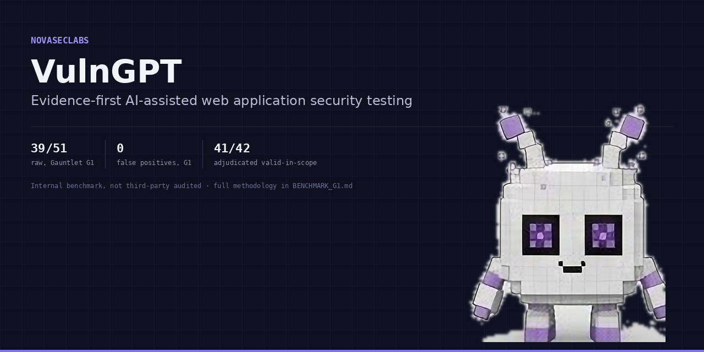
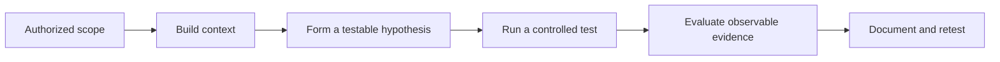
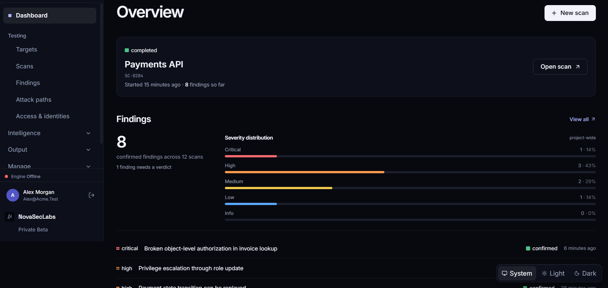
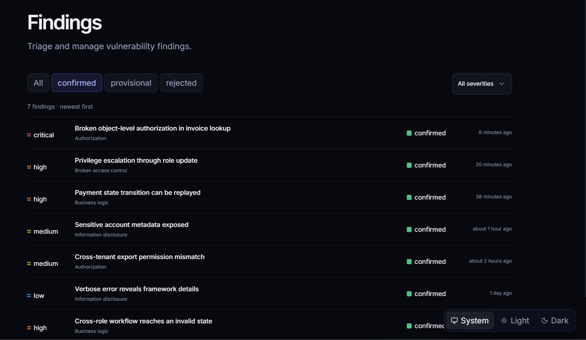

# VulnGPT



**AI-assisted web application security testing focused on behavior, authorization, and evidence.**

VulnGPT is a NovaSecLabs product in private beta. It is being developed to help security practitioners and application builders investigate weaknesses that emerge from the relationships between identities, permissions, objects, sessions, and multi-step business workflows.

A suspicious response is a lead to investigate—not proof of a vulnerability.

<p align="left">
  <a href="https://www.novaseclabs.com/waitlist"><strong>Request private beta access ↗</strong></a>
  &nbsp;·&nbsp;
  <a href="https://www.novaseclabs.com">NovaSecLabs</a>
  &nbsp;·&nbsp;
  <a href="https://showcase.novaseclabs.com/docs/">Browse documentation</a>
</p>

---

## Product overview

Traditional automated testing is often strongest when a weakness can be expressed as a recognizable input and response. Important application-security failures can be harder to isolate: the behavior may depend on who is acting, which session is active, who owns an object, what happened earlier in a workflow, or which state transition the application permits.

VulnGPT is being developed around that harder problem: testing application behavior in context and requiring a defensible basis before a suspected issue is treated as a finding.

### What the product is designed to investigate

| Investigation area | Security question |
| --- | --- |
| Authorization boundaries | Can one actor access or modify an object outside their permissions or ownership? |
| Authenticated workflows | Does behavior change correctly across sessions, identities, and sequential actions? |
| Multi-role applications | Are role boundaries consistently enforced across endpoints and workflow transitions? |
| Business logic | Can a user violate an application rule by combining otherwise valid actions? |
| Stateful behavior | Does the application preserve its security invariants as records and workflow states change? |
| Interference and ambiguity | Could throttling, WAF behavior, session expiry, or changing state explain an observed signal? |

These are product focus areas, not a guarantee that every vulnerability class or application workflow is currently supported. VulnGPT is in private beta; scope and availability should be confirmed during evaluation.

## The validation approach

The product is designed around a disciplined progression from an observation to a result that a human can inspect.



1. **Establish context.** Identify relevant actors, sessions, objects, roles, preconditions, and application state.
2. **State the invariant.** Define the security rule the application is expected to enforce.
3. **Form a hypothesis.** Describe a specific way that rule might be violated.
4. **Test the boundary.** Use controlled, authorized actions to distinguish a genuine weakness from an alternative explanation.
5. **Evaluate evidence.** Examine the observed behavior, relevant controls, reproducibility, and impact.
6. **Preserve the result.** Keep the reasoning and evidence clear enough for review and retesting.

Read the full [Evidence and Validation Standard](docs/EVIDENCE_AND_VALIDATION.md) and [Technical Approach](docs/TECHNICAL_APPROACH.md).

## Product principles

- **Evidence before conclusions.** A signal should not become a security finding merely because a response looks unusual.
- **Context matters.** Identity, permissions, ownership, session continuity, and workflow state can change the meaning of a request.
- **Falsification matters.** A credible validation process should test alternative explanations, not only seek confirmation.
- **Reproducibility matters.** Results should describe the conditions and behavior needed for a reviewer to check them.
- **Human judgment remains essential.** Automated analysis supports security work; it does not remove the need for authorization, review, or professional judgment.

## Who it is for

**Application security practitioners and penetration testers** investigating authorization, state, and business-logic weaknesses.

**Product security and engineering teams** seeking a clearer way to reason about application behavior across users, roles, and workflows.

**Founders and application builders** who need security findings explained in terms of the application behavior they can understand and fix.

## Public showcase

The public product showcase is available at [showcase.novaseclabs.com](https://showcase.novaseclabs.com/). The searchable [documentation library](https://showcase.novaseclabs.com/docs/) and [visual product walkthrough](https://showcase.novaseclabs.com/product/) are part of the same public site. The source and publication standards remain available in this repository.

## Product interface captures

The showcase includes genuine interface screenshots supplied for the public product walkthrough: the dashboard, findings queue, a BOLA finding detail, Live Vision, and Elite Red Team Reports.

| Product area | Capture |
| --- | --- |
| Workspace dashboard |  |
| Findings queue |  |
| Finding detail |  |
| Live Vision |  |
| Elite Red Team Reports |  |

See the [visual product walkthrough](https://showcase.novaseclabs.com/product/) for full-size captures and context. These are static captures, not a live product session. Workspace labels, counts, statuses, and controls reflect the moment captured and must not be interpreted as live telemetry, customer outcomes, or guaranteed current availability. The report screenshot explicitly shows generation and download disabled by export policy.

## Documentation

Browse the [searchable VulnGPT documentation library](https://showcase.novaseclabs.com/docs/), organized by product, technical, practitioner, enterprise, and governance topics.

| Document | What it covers |
| --- | --- |
| [Product Overview](docs/PRODUCT_OVERVIEW.md) | Product purpose, intended users, problem definition, and boundaries |
| [Technical Approach](docs/TECHNICAL_APPROACH.md) | Contextual testing model and conceptual workflow |
| [System Overview](docs/SYSTEM_OVERVIEW.md) | Public conceptual investigation flow and trust boundaries—not deployed architecture |
| [Evidence and Validation](docs/EVIDENCE_AND_VALIDATION.md) | Evidence quality, controlled testing, confirmation, and retesting |
| [Enterprise Evaluation](docs/ENTERPRISE_EVALUATION.md) | Buyer diligence checklist and security questionnaire |
| [Security and Privacy](docs/SECURITY_AND_PRIVACY.md) | Public security posture, data-handling questions, and evaluation boundaries |
| [Security Model](docs/SECURITY_MODEL.md) | Public trust boundaries, assets, threat scenarios, and assurance limits |
| [Use Cases](docs/USE_CASES.md) | Representative application-security scenarios |
| [Security Testing Playbook](docs/SECURITY_TESTING_PLAYBOOK.md) | Practical, controlled test-design patterns for authorized assessments |
| [Capability Evaluation Matrix](docs/CAPABILITY_EVALUATION_MATRIX.md) | Scenario selection and evidence criteria; not a support guarantee |
| [Controlled Evaluation Protocol](docs/EVALUATION_PROTOCOL.md) | Pre-registration, ground truth, outcomes, and scoring discipline |
| [Public Evaluation Schemas](schemas/README.md) | Optional JSON interchange schemas; not product API contracts |
| [Assessment Plan Template](docs/ASSESSMENT_PLAN_TEMPLATE.md) | Engagement scope, identities, constraints, and approvals worksheet |
| [Finding Report Standard](docs/FINDING_REPORT_STANDARD.md) | Evidence-led security finding structure and reporting rules |
| [Benchmark Governance](docs/BENCHMARK_GOVERNANCE.md) | Reproducibility, scoring integrity, and publication approval gates |
| [Glossary](docs/GLOSSARY.md) | Shared application-security terminology |
| [Release Process](docs/RELEASE_PROCESS.md) | Review and publication process for this public repository |
| [FAQ](docs/FAQ.md) | Product, access, scope, and publication questions |
| [Claims and Messaging](CLAIMS.md) | Approved public language and claims that must not be made |
| [Benchmark publication status](BENCHMARK_G1.md) | Current status of public benchmark publication |
| [Security Policy](SECURITY.md) | Private vulnerability-reporting instructions |
| [Contribution Guide](CONTRIBUTING.md) | Scope and standards for changes to this public repository |
| [Support](SUPPORT.md) | Where to ask product questions and report showcase issues |
| [Changelog](CHANGELOG.md) | Public repository and documentation change history |

## Product status

VulnGPT is in **private beta**. Access is currently handled through the [NovaSecLabs private-beta application](https://www.novaseclabs.com/waitlist).

This repository is the public showcase website and its supporting documentation. It is not the VulnGPT scanning engine, production backend, deployment configuration, or a complete source release. Proprietary implementation details, credentials, private customer material, and operational infrastructure are intentionally excluded.

No public claim is made here that VulnGPT is independently certified, SOC 2 attested, ISO 27001 certified, or independently benchmark-audited. See [Security and Privacy](docs/SECURITY_AND_PRIVACY.md) for the appropriate enterprise evaluation questions.

## Repository maintenance

This repository uses a dependency-free local quality check for relative links, required metadata, accessibility entry points, and publication guardrails. Run it before submitting a documentation or website change:

```bash
node scripts/validate-public-repo.mjs
```

See [Repository Maintenance](docs/REPOSITORY_MAINTENANCE.md), the [Changelog](CHANGELOG.md), and [Support](SUPPORT.md).

## Responsible use

VulnGPT is intended only for applications and infrastructure that the operator owns or is explicitly authorized to test. Define the permitted scope, use approved test identities, and avoid destructive actions or production data unless the system owner has explicitly approved them.

See [Responsible Testing](docs/RESPONSIBLE_TESTING.md) and the [Security Testing Playbook](docs/SECURITY_TESTING_PLAYBOOK.md) for practical guidance. Reusable worksheets are available in [templates/](templates/).

---

**Built by [NovaSecLabs](https://www.novaseclabs.com).**

Security testing should produce evidence, not noise.
