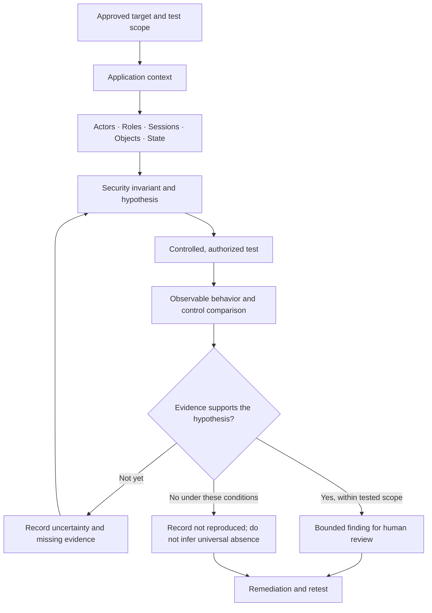
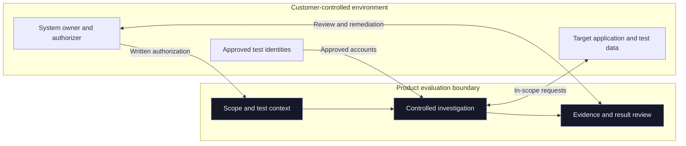

# VulnGPT — Public System Overview

## Status and scope

This is a **conceptual product model** intended to explain the security problem and evaluation boundaries. It is not a production architecture diagram, source-code description, component inventory, or guarantee that each conceptual stage is implemented or available in the current private beta.

VulnGPT is in private beta. Confirm the current evaluation environment, supported workflow, data flow, deployment model, and controls directly with NovaSecLabs before using sensitive applications or data.

## The problem model

Application-security behavior is contextual. An operation can depend on the actor, role, tenant, session, resource owner, workflow state, and sequence of prior actions. A request/response pair may not carry enough information to establish whether a security rule was violated.

The public product direction is organized around six conceptual responsibilities:

1. **Scope and authorization:** define the approved target and permitted actions.
2. **Context:** identify relevant actors, sessions, objects, and state.
3. **Hypothesis:** express the expected security invariant and a falsifiable violation.
4. **Controlled testing:** compare behavior under bounded, authorized conditions.
5. **Evidence evaluation:** examine direct observations, control cases, and alternative explanations.
6. **Review and retest:** preserve a bounded conclusion and a repeatable verification path.

## Conceptual investigation flow

The flow intentionally separates testing from adjudication. A completed request is not automatically a confirmed issue, and a scenario that could not be observed is not a clean negative.

## Conceptual trust boundaries

The following diagram is a review aid, not a representation of deployed services or network topology.

This conceptual diagram does not assert a particular hosting provider, service topology, isolation mechanism, storage design, model-provider path, or customer-managed deployment option.

## Security invariants

| Boundary | Example invariant |
| --- | --- |
| Identity | An action is attributed to the correct authenticated actor |
| Role | A role cannot perform an operation outside its effective permissions |
| Tenant | One organization cannot access another organization's private data |
| Ownership | An actor cannot read or mutate an object outside the actor's permitted ownership boundary |
| Workflow | A protected transition requires its stated preconditions |
| Session | Logout, expiry, or revocation invalidates the expected access path |
| Evidence | A reported conclusion does not exceed what the test actually observed |

## What this document does not establish

It does not establish actual service or network architecture, data residency, encryption design, retention settings, exact model providers or subprocessors, support for enterprise identity protocols, an SLA, recovery objectives, independent security certification, or that all conceptual responsibilities are automated or available for every beta account.

Use the [Security and Privacy](SECURITY_AND_PRIVACY.md) and [Enterprise Evaluation](ENTERPRISE_EVALUATION.md) documents to structure current, environment-specific questions.

## Related resources

- [Technical Approach](TECHNICAL_APPROACH.md)
- [Security Model](SECURITY_MODEL.md)
- [Security Testing Playbook](SECURITY_TESTING_PLAYBOOK.md)
- [Evidence and Validation](EVIDENCE_AND_VALIDATION.md)
