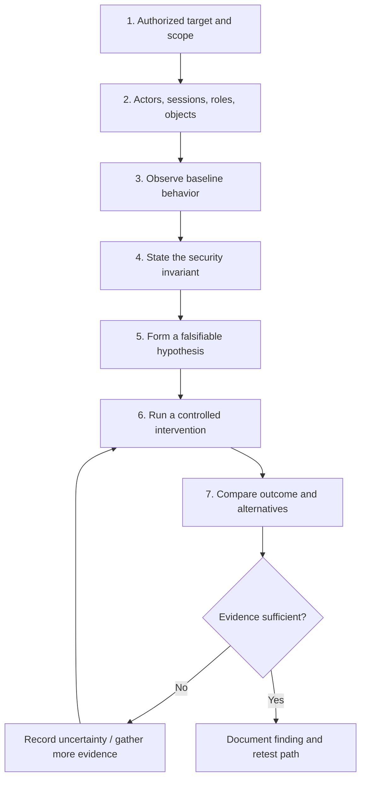

# Technical Approach

This document describes VulnGPT's public-facing conceptual model. It is not an implementation specification, a promise of support for every workflow, or a disclosure of proprietary engine internals.

## Why context changes the test

A web application request does not have a security meaning in isolation.

Consider a request to retrieve an invoice. Its expected result may depend on the authenticated user, the user's organization, the invoice owner, the role assigned to that user, and the invoice's state. The same endpoint and object identifier can be legitimate in one context and unauthorized in another.

A useful test must preserve the context needed to interpret the result.

## Conceptual investigation model

### 1. Establish authorized scope

Testing begins with a defined target and explicit authorization. The operator should understand permitted hosts, accounts, environments, test windows, data boundaries, and prohibited actions before execution.

### 2. Build an application context

The relevant context may include:

- actors and authenticated identities;
- roles, permissions, and organizational boundaries;
- sessions, tokens, and authentication state;
- objects and their owners or tenants;
- workflow state and relevant prior actions;
- preconditions and expected application behavior.

The exact context required depends on the application and hypothesis. Not every investigation needs every item.

### 3. Observe baseline behavior

A baseline establishes what the application does under a known, permitted set of conditions. Without a useful baseline, a later difference may be difficult to interpret.

The baseline should record enough information to distinguish actor, object, action, state, and outcome without unnecessarily collecting secrets or unrelated personal data.

### 4. State the security invariant

An invariant is the security expectation that should remain true across relevant actions and state changes.

Examples:

- A user must not read another tenant's private record.
- A lower-privileged role must not perform an administrative transition.
- A workflow action must not be accepted before its required precondition.
- An object update must not silently change ownership or bypass an approval rule.

A well-formed invariant is specific enough to test and review.

### 5. Form a falsifiable hypothesis

A useful hypothesis identifies the actor, action, resource, precondition, expected restriction, and possible observable violation.

For example:

> Given two authorized test users in separate tenants, an authenticated request made by the first user should not reveal or modify a private object owned by the second user.

The hypothesis should describe what would count as supporting evidence and what observations would weaken it.

### 6. Run a controlled intervention

Change one relevant variable at a time where practical: actor, role, object owner, session, workflow state, or action sequence. Keep the test within scope and use safe test records.

Controlled comparisons make it easier to distinguish authorization failures from unrelated response differences.

### 7. Evaluate the outcome

A response code or textual difference is rarely sufficient on its own. Interpretation should consider observable data exposure, state changes, side effects, the control case, repeatability, and plausible alternatives such as caching, stale sessions, throttling, or environmental instability.

### 8. Preserve a reviewable result

A useful result should explain the security expectation, test context, action taken, observed outcome, impact, limitations, and safe reproduction path. Retesting should determine whether the relevant behavior has changed—not merely whether an endpoint now returns a different status code.

## Conceptual separation of stages

| Stage | Main question | Output |
| --- | --- | --- |
| Discovery | What behavior or surface is available to investigate? | Candidate behavior |
| Context | Which actor, object, permission, and state matter? | Test context |
| Hypothesis | What security rule could be violated? | Falsifiable hypothesis |
| Validation | What controlled test distinguishes the hypothesis from alternatives? | Observations and control comparison |
| Adjudication | Does the evidence support the claimed weakness? | Bounded conclusion |
| Retest | Does the same security invariant now hold? | Updated verification record |

The stages are conceptually distinct even when a practical workflow revisits earlier stages.

## Design boundaries

- A successful HTTP response does not establish unauthorized access.
- A failed request does not establish that authorization is correct.
- A WAF block is not proof that the underlying application is secure.
- A timeout is not proof that a vulnerability exists or does not exist.
- An unusual response is not automatically a finding.
- A valid test in one state does not establish behavior in every role, tenant, or workflow state.

## Implementation boundary

This public document intentionally omits proprietary detection logic, internal service topology, deployment architecture, credentials, and customer-specific material. It describes the conceptual approach, not source-level implementation.

For product availability and supported evaluation workflows, use the [private-beta application](https://www.novaseclabs.com/waitlist).
